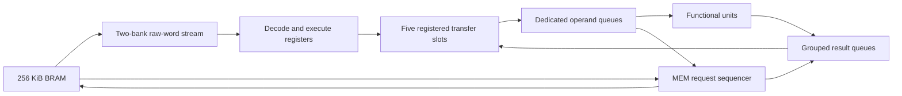

# ECP5 architecture decision record

**Status** — Implemented and validated in RTL simulation. Timing closure for
the full CoreMark comparison image remains open.

**Baseline** — `42a5a3a`, targeting the LFE5UM5G-85F-8BG381 with a 25 MHz
CPU timing target.

## Decision

Keep the 64-bit datapath and instruction format, five registered transfer
slots, and dedicated functional-unit queues. Fetch through a 16-word rolling
instruction window backed by 256 KiB of on-chip BRAM. Default to single-port
BRAM, fast ALU mode 2, and eight words each of instruction lookahead and
history. Keep separate clock inputs for the four iterative math units.

The design has two performance measures. The RTL benchmarks measure clocks
per workload and verify results. FPGA synthesis and place and route measure
resource use and achievable frequency. Placement estimates guide
experimentation. A completed route is required for a routed frequency.

## How the current design is built



### Fetch and control

- `mdma_instruction_stream` stores raw 64-bit words and their error bits in
  two interleaved LUTRAM banks. It exposes two words and their valid bits,
  reserves room for outstanding fetches, and accepts zero, one, or two pops
  per edge. The BRAM port supplies at most one raw word per clock. A stream
  of extended-immediate instructions consumes two words per instruction.
- `mdma_cpu` owns instruction decoding and the registered execute state.
  An opcode and its buffered extended immediate can enter together. When
  the immediate is delayed, independent moves can proceed while `CONST`
  waits. Synchronized instructions require all their moves to be ready.
  Fetch errors become architectural faults when the decoder needs the word.
- An accepted PC write can redirect once the current immediate is ready.
  The stream registers the target and seeks to it on a resident hit. A miss
  drops the window and uses a cancellation cycle to discard a stale reply.
  The active instruction retains its own `CONST` and `PC_NEXT` until it
  retires. `CPU.PC_REL` adds eight times its displacement to `PC_NEXT`.
  Program code is assumed immutable during execution. Stores leave
  buffered instruction words intact.

### Transport, storage, and clocks

- Decode registers the move selectors. In execute, each slot selects a
  source and checks source readiness and sink capacity. Readiness selectors
  use three LUT4 tiers. Each 64-bit payload uses a four-by-16 source
  selection and a final four-way selector. The sink side selects from the
  five registered words. Dispatch reserves space before writeback and can
  accept another five ready moves while the previous pack writes back.
- The transport uses 45 dedicated operand FIFOs and 27 result banks. Most
  FIFO instances are eight entries deep. CPU-clock full-width operand
  banks use EBR, and narrow operands and CPU-clock result banks use
  distributed RAM. CMP, BITCNT, and PACK store 6, 21, and 136 bits per
  result generation respectively. Sibling outputs share an entry and
  their pop requests are ORed. Slot replay preserves a sibling needed by
  a move that could not dispatch with the other moves.
- STASH and STACK each use a direct 16-entry bank per instance. Dispatch
  reserves the write and forwarding makes it visible on the next clock.
  STACK reads the newest accepted unpopped value. `CPU.COND` has its own
  eight-entry FIFO of truth bits and forwards a writeback value when empty.
- Each FU family has its own RTL module selected at elaboration. Fast
  mode 2 lets local ALUs, including SHIFT, consume an arriving operand on
  writeback and enqueue their result on that edge. The buffered timing
  bench measured two clocks from dispatch to dependent use for all 16
  local ALU instances and one request per clock when the queues have room.
  The one-clock local ALU figure measures operand pop through result
  enqueue, inclusive.
- MUL, MULS, DIV, and DIVS each connect through dedicated dual-clock
  operand and result FIFOs. Two-stage Gray-pointer synchronization keeps
  full and empty checks local to each domain. The engines take 7 multiply
  or 67 divide FU clocks in the isolated bench. CPU-visible latency also
  includes transport and synchronization. The board benchmark ties the
  math clocks to the CPU clock and still exercises the CDC FIFOs.
- `mdma_soc` arbitrates native instruction and data requests on the CPU
  clock. Data wins single-port BRAM arbitration. The BRAM replies one
  clock after acceptance and uses native byte write enables. MEM queues
  ready read and store operands in arrival order and services a swap as
  a read followed by a write. The optional dual-port build allows concurrent
  instruction and data access and interlocks same-word instruction reads
  against writes. UART MMIO also runs on the CPU clock.

## Experiments and outcomes

| Experiment | Result and decision |
| --- | --- |
| Direct source selection at every sink | Passed simulation and expanded to 179,757 combinational sites on an 83,640-site device. Keep the five intermediate slots. |
| Register the five transfer slots | The matched historical −7 placement median rose from 32.42 to 38.45 MHz with one-edge STASH/STACK and physical FIFO credits. Dispatch-side STASH fullness reached 38.87 MHz. The two-edge storage variant measured 32.37 MHz. Keep the slot register, explicit credits, and next-clock storage forwarding. |
| Move operand FIFOs to LUTRAM or registers | All-distributed operand banks removed 67 historical EBR allocations and reduced the placement median from 32.07 to 29.77 MHz. ARITH-only registers raised it to 33.65 MHz while increasing FF use. Later LUTRAM trials with extra ingress and head registers increased FF use and latency and reached only 31.11 MHz median versus 36.95 MHz for their matched baseline. Keep mixed memory mapping. |
| Shorten local FU paths | Fast modes reached one request per clock. Two-stage SHIFT took three dispatch-to-use clocks in mode 1, and single-stage SHIFT took two in mode 2. The older cache-bound CoreMark image gained little from the ALU change alone. Keep fast mode 2 with the 25 MHz target. |
| Narrow payloads to 32 bits | The sizing prototype reduced combinational sites from 42,988 to 29,405 and raised the placement median from 36.95 to 39.01 MHz. It retained the 64-bit instruction and PC path and its route timed out. Keep the 64-bit ISA and datapath. |
| Prefetch raw words through an external bus cache | The 64-word hard-flush stream and 4 KiB external cache reduced the historical SRAM CoreMark run from 44,908,396 to 12,051,683 workload clocks. `sum_to` rose from 111 to 146 clocks as frequent redirects discarded prefetch. Keep raw-word streaming and decoder-owned immediates. |
| Retain a rolling history | The 16/8 configuration led the 8/4, 16/8, and 32/16 rolling variants on estimated throughput in the matched SRAM sweep. `sum_to` improved from 146 to 81 clocks against the 64-word hard-flush baseline. Estimated CoreMark throughput fell 5.7% because most redirects missed and paid the lookup. Keep 16/8 as a configurable default. |
| Replace external SRAM and its Wishbone/cache path with BRAM | The matched CoreMark run fell from 12,344,287 to 6,359,670 clocks. Dual-port BRAM saved another 10,101 clocks, about 0.16%, and removed instruction-port arbitration waits. Single port had the higher three-seed −8 placement median, 44.36 versus 41.84 MHz. Keep single port as the provisional default. |

The historical trials used different RTL and software snapshots. Compare
the figures within each experiment. The [FPGA reference](fpga.md) preserves
the full seed tables, test conditions, and latency definitions.

## Verification and remaining limits

At `42a5a3a`, `just report-status` with patched cproc and the QBE ECP5
schedule validated the following workloads.

| Workload | One-clock simulator workload / total clocks | ECP5 workload / total clocks |
| --- | ---: | ---: |
| CoreMark | 925,741 / 973,584 | 2,303,676 / 2,419,245 |
| `sum_to(10)` | 25 / 31 | 58 / 96 |
| `mix_loop(32, 0x12345678, 0x9e3779b1)` | 456 / 464 | 1,567 / 1,609 |

CoreMark measured **1.08021574 CoreMark/MHz** in the one-clock simulator
and **0.43408882 CoreMark/MHz** on the ECP5 RTL. ECP5 retired 1,015,342
instructions. Its remaining clocks comprised 816,949 other execute waits,
198,104 next-instruction stalls, 157,299 redirect stalls, 100,529 decode
bubbles, and 15,453 CONST stalls. The instruction stream recorded 26,355
resident redirects and 72,719 misses. The largest measured cost is waiting
within an active instruction.

The same-clock CoreMark comparison build packed to **43,461 combinational
sites, 7,866 FFs, 180 of 208 EBRs, and 32 multipliers**. Main memory accounts
for 128 EBRs and CPU operand FIFOs account for the remaining 52. The default
−8 placement estimated 43.28 MHz. Router1 was stopped after more than 15
minutes. Alternate Router2 placements and LUT4-only mapping retained
routing conflicts. The LUT4-only run reached a low of 7,340 overused wires
before the count rose again. This image has no verified routed Fmax.

The earlier single-port BRAM sweep's median placement traced its longest
CPU path from the CPU-side MULS result FIFO pointer through readiness and
dispatch into a slot payload register. Interconnect contributed 19.29 ns
of the 22.54 ns estimated delay. Other snapshots and seeds put the limiting
path through replay, retirement, or redirect logic. The 64-way selector's
LUT count describes only one part of those paths.

## Reproduce the build

```sh
just rtl-test
just rtl-benchmark
just report-status
MDMA_BRAM_IMAGE=program.bin just fpga-build
```

`just rtl-test` checks architectural results. `just rtl-benchmark`
measures dispatch width, FU latency, and storage visibility separately.
The board build generates the port definitions, pads the little-endian
image to 256 KiB, synthesizes `mdma_ecp5` with Yosys, places and routes
with nextpnr, and packs the resulting configuration with ecppack. Set
`MDMA_ECP5_LPF` for the physical board. The default `fpga-build` top
exposes the four math clocks. The [CPU comparison harness](fpga-comparison.md)
ties all clocks together and uses the same BRAM and UART.

The build and RTL tools share `MDMA_FAST_ALU`, `MDMA_STREAM_WORDS`,
`MDMA_STREAM_AHEAD_WORDS`, and `MDMA_BRAM_PORTS` settings. See the
[FPGA reference](fpga.md) for legal values and the [QBE backend](qbe.md)
for the scheduling profile. The profile still uses SRAM-era memory
estimates. RTL counters provide the workload measurements above.
